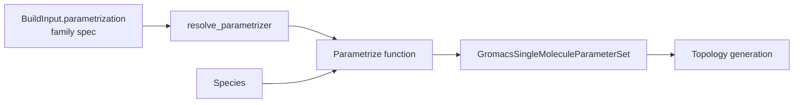

This guide explains how parametrization is organized in MDFactory and how to add a new
small-molecule force field or a new force-field family.

<Callout type="info">
  Currently, MDFactory only supports GROMACS as an MD engine. When adding a new parametrization method, you'll implement it for GROMACS first. Support for other engines can be added later following the same patterns.
</Callout>

## Architecture overview



1. **Family specs** (`mdfactory/models/parametrization.py`): `CharmmParametrization`,
   `AmberParametrization` and `OpenFFParametrization` describe each component (protein, small
   molecules, water, ions) by force field. `BuildInput.parametrization` is a discriminated union
   on `family`; a bare string is shorthand for `{family: <name>}`.
2. **Resolution** (`BuildInput` validator → `spec.resolve(simulation_type)`): fills the family
   defaults for the simulation type, sets components that do not apply to `None`, and rejects
   unsupported combinations.
3. **Dispatch** (`mdfactory/parametrize.py`): `resolve_parametrizer(spec, engine, native_forcefield)`
   picks the function in `DISPATCH_ENGINE_PARAMETRIZE[engine][spec.small_molecules.kind]`.
4. **Parameter sets** (`GromacsSingleMoleculeParameterSet`): record the paths plus `component`,
   `forcefield`, `charge_method`, `water_model` and the `topology_merge` kind.

The spec also exposes `nonbonded_scheme` (selects the nonbonded block of the generated run
schedule) and `components()` / `summary()` (metadata, dry-run output).

## The parametrizer contract

Every function in `DISPATCH_ENGINE_PARAMETRIZE` is called as

```python
parametrize(species, spec=<resolved family spec>, native_forcefield=<NativeForceField | None>)
```

and returns a `GromacsSingleMoleculeParameterSet`. It must handle three kinds of species:

- **small molecules**: generate (or reuse cached) parameters
- **water** (`species.is_water`): use `spec.water_model`
- **ions** (`species.is_ion`, Na⁺/Cl⁻; moleculetypes from `NATIVE_SPECIES` in `mdfactory/models/species.py`)

`native_forcefield` is set for protein builds: a `NativeForceField(name, directory, water_model)`
pointing at the bundled protein force field. Water and ions must then come from that directory
(no cache access) and carry `topology_merge="native"`.

### Caching and locking

- Cache under `settings.parameter_store / "gromacs" / <your root>`, with a key that contains
  every input that changes the parameters.
- Lock exactly the directory you write (`lock_local_folder(workdir)`), check the cache inside the
  lock, and remove and regenerate an incomplete directory. The OpenFF implementation
  (`OpenFFCacheEntry`, `_ensure_openff_entry`) writes a completion marker last and only reuses
  entries that have it.

### Topology merge kinds

`topology_merge` tells the topology writers how to combine sets:

| Kind | Meaning |
|------|---------|
| `cgenff` | Atom types are shared with the CHARMM force field; types already defined by the force field are de-duplicated after a compatibility check. |
| `smirnoff` | Atom types are private to the set and the set carries its own `[ defaults ]`. The `[ defaults ]` must match the force field before it is dropped, and atom-type names must not collide. |
| `native` | Water/ion topology from a force-field directory; no parameters are merged. |

Private atom types must be unique per parameter set. The OpenFF parametrizer renames
Interchange's resname-derived types with `rename_atomtypes(itp, atomtypes, prefix)`
(`mdfactory/utils/topology_utilities.py`).

## Adding a small-molecule force field

### Step 1: Add a component model

In `mdfactory/models/parametrization.py`, add a frozen component model with a `kind` class
variable and a `describe()` method:

```python
class GaffSmallMolecules(BaseModel):
    """GAFF2 small-molecule parameters via AmberTools."""

    model_config = ConfigDict(extra="forbid", frozen=True)

    kind: ClassVar[str] = "gaff"

    forcefield: Literal["gaff2"] = Field("gaff2", description="GAFF version.")
    charge_method: Literal["am1bcc", "bcc"] = Field("am1bcc", description="antechamber charges.")

    def describe(self) -> str:
        return f"{self.forcefield} (charges: {self.charge_method})"
```

Use `extra="forbid"` (typos are errors) and `frozen=True`, and give every field a default.

### Step 2: Use it in a family

Either accept it in an existing family (e.g. as an alternative in `AmberParametrization.small_molecules`)
or create a new family (see below).

### Step 3: Implement the parametrizer

```python
def parametrize_gaff_gromacs(
    species: SingleMoleculeSpecies, spec, native_forcefield: NativeForceField | None = None
) -> GromacsSingleMoleculeParameterSet:
    """Parametrize a species with GAFF for GROMACS."""
    if native_forcefield is not None and (species.is_water or species.is_ion):
        ...  # return the native water/ion set from native_forcefield.directory

    small_molecules = spec.small_molecules
    key = {"format": 1, "forcefield": small_molecules.forcefield,
           "charge_method": small_molecules.charge_method}
    workdir = settings.parameter_store / "gromacs" / "gaff" / _key_digest(key) / species.hash
    workdir.parent.mkdir(parents=True, exist_ok=True)
    with lock_local_folder(workdir):
        if not _complete(workdir):
            shutil.rmtree(workdir, ignore_errors=True)
            workdir.mkdir()
            ...  # antechamber, parmchk2, conversion to GROMACS, unique atom types
    return GromacsSingleMoleculeParameterSet(
        moleculetype=species.hash,
        smiles=species.smiles,
        component="small_molecule",
        forcefield=small_molecules.forcefield,
        charge_method=small_molecules.charge_method,
        topology_merge="smirnoff",  # private atom types + own [ defaults ]
        itp=workdir / f"{species.hash}.itp",
        parameter_itp=workdir / f"{species.hash}_params.itp",
        forcefield_itp=None,
    )
```

### Step 4: Register it

```python
DISPATCH_ENGINE_PARAMETRIZE = {
    "gromacs": {
        "cgenff": parametrize_cgenff_gromacs,
        "openff": parametrize_openff_gromacs,
        "gaff": parametrize_gaff_gromacs,  # keyed by the component's kind
    }
}
```

The builders call `resolve_parametrizer(inp.parametrization, inp.engine, ...)`; no change in
`build.py` is needed.

## Adding a force-field family

Subclass `_FamilySpec` and set its class variables:

```python
class GaffParametrization(_FamilySpec):
    simulation_types: ClassVar[frozenset[str]] = frozenset({"mixedbox", "bilayer", "lnp"})
    default_protein: ClassVar[Optional[str]] = None
    default_water_model: ClassVar[str] = "tip3p"

    family: Literal["gaff"] = "gaff"
    small_molecules: Optional[GaffSmallMolecules] = None

    @property
    def nonbonded_scheme(self) -> NonbondedScheme:
        return "sage"

    @property
    def ions(self) -> Optional[str]:
        return "joung-cheatham"

    def _check_simulation_type(self, simulation_type: str) -> None:
        ...  # optional: per-type restrictions on the resolved components
```

The default small-molecule spec is the model named in the `small_molecules` annotation. Add the
family to `FAMILY_SPECS` and to the `ParametrizationSpec` union with a `Tag("gaff")`.
If the family needs its own nonbonded settings, add a new `NonbondedScheme` value and its overlay
in `mdfactory/run_schedules/gromacs.py`: an entry in `NONBONDED` (electrostatics and van der
Waals keys) and one in `DISPCORR` (the dispersion correction per simulation type). Extend the
nonbonded table in `mdfactory/tests/test_run_schedules.py` and the table in the Simulation
Settings user guide.

## Tests

Add tests in `mdfactory/tests/test_parametrization.py` and
`mdfactory/tests/test_parametrization_schema.py`:

- the family parses in shorthand and explicit form with the same hash, and its rejection rules
- water, ions and small molecules produce parameter sets with the right `component`,
  `forcefield` and `topology_merge`
- the cache key changes with every input that changes the parameters, and incomplete entries
  are regenerated
- the locked path equals the written directory (record `lock_local_folder` calls with monkeypatch)
- atom types of two different molecules never collide

Use a temporary parameter store:

```python
@pytest.fixture
def parameter_store(tmp_path, monkeypatch):
    from mdfactory.settings import settings
    store = tmp_path / "parameters"
    monkeypatch.setattr(settings, "parameter_store", store)
    return store
```

## File structure summary

```
mdfactory/
├── models/
│   └── parametrization.py  # component model, family spec, FAMILY_SPECS, ParametrizationSpec
├── parametrize.py          # parametrizer + DISPATCH_ENGINE_PARAMETRIZE entry
├── run_schedules/
│   └── gromacs.py          # NONBONDED / DISPCORR overlay for a new nonbonded scheme
└── tests/
    ├── test_parametrization.py
    └── test_parametrization_schema.py
```

## Checklist

- [ ] Component model (frozen, `extra="forbid"`, defaults, `kind`, `describe()`)
- [ ] Family spec (or an existing family) accepts the component, with per-type validation
- [ ] Parametrizer follows the contract and handles water, ions and native force fields
- [ ] Cache key covers every parameter-changing input; the written directory is locked
- [ ] Private atom types are unique per parameter set
- [ ] Registered in `DISPATCH_ENGINE_PARAMETRIZE`
- [ ] Nonbonded overlay for a new nonbonded scheme, if needed
- [ ] Tests and documentation updated

## Next steps

<Cards>
  <Card title="Architecture" href="/docs/developer-guide/architecture" />
  <Card title="Extending Engines" href="/docs/developer-guide/extending-engines" />
  <Card title="Testing" href="/docs/developer-guide/testing" />
</Cards>
