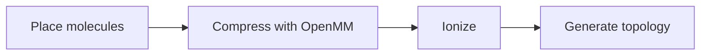
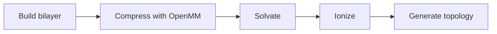
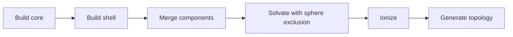
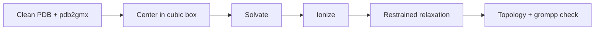
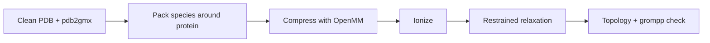

MDFactory supports five system-building strategies. Each uses different Pydantic composition models and build functions: three for small-molecule and lipid systems (`mixedbox`, `bilayer`, `lnp`) and two for a protein in solution (`proteinbox`, `protein_mixedbox`).

## Mixed Box

Creates a homogeneous mixture of molecules in a rectangular box. Molecules are packed to a target density using OpenMM compression.



### Use cases

- Solution simulations (solvent + solute)
- Polymer blends
- Small molecule mixtures
- Bulk liquid properties

### Configuration

```yaml
engine: gromacs
simulation_type: mixedbox
parametrization: openff

system:
  species:
    - smiles: "O"
      resname: SOL
      count: 900
    - smiles: "CCO"
      resname: ETH
      count: 100
  target_density: 1.0
  ionization:
    neutralize: true
    concentration: 0.15
```

### MixedBoxComposition fields

| Field | Type | Default | Description |
|-------|------|---------|-------------|
| `species` | list of `SingleMoleculeSpecies` | — | Molecules in the system |
| `total_count` | int \| null | null | Total molecule count (used with fractions) |
| `target_density` | float | 1.0 | Target density in g/cm³ |
| `ionization` | IonizationConfig \| null \| false | see below | Ion placement settings; `null` or `false` disables ionization |

### Tips

- Use `count` for absolute molecule numbers or `fraction` for molar ratios (with `total_count`)
- `target_density` determines the box size — no need to specify box dimensions
- Fractions must sum to 1.0 across all species

## Bilayer

Builds lipid bilayer systems with water on both sides. Uses OpenMM compression to assemble the bilayer structure, then solvates and ionizes.



### Use cases

- Membrane simulations
- Lipid phase behavior
- Drug permeation studies
- Bilayer property calculations (APL, order parameters, thickness)

### Configuration

```yaml
engine: gromacs
simulation_type: bilayer
parametrization: charmm

system:
  species:
    - smiles: "CCCCCCCCCCCCCCCC(=O)OC[C@H](COP(=O)([O-])OCC[N+](C)(C)C)OC(=O)CCCCCCC/C=C\\CCCCCCCC"
      resname: POC
      count: 128
      head_atoms: [32, 33, 34, 35, 36, 37, 38, 39, 40, 41]
      tail_atoms: []
  z_padding: 20.0
  monolayer: false
  ionization:
    neutralize: true
    concentration: 0.15
```

### BilayerComposition fields

| Field | Type | Default | Description |
|-------|------|---------|-------------|
| `species` | list of `LipidSpecies` | — | Lipid molecules (uses `LipidSpecies` with head/tail atom indices) |
| `total_count` | int \| null | null | Total lipid count (used with fractions) |
| `z_padding` | float | 20.0 | Water padding above/below bilayer in Å |
| `monolayer` | bool | false | Build a monolayer instead of bilayer |
| `ionization` | IonizationConfig \| null \| false | see below | Ion placement settings; `null` or `false` disables ionization |

### LipidSpecies fields

| Field | Type | Default | Description |
|-------|------|---------|-------------|
| `smiles` | string | — | Canonical SMILES |
| `resname` | string | — | Residue name (max 3 chars) |
| `count` or `fraction` | int or float | — | Number or molar fraction |
| `head_atoms` | list of int | [] | 0-based atom indices for headgroup (auto-detected if empty) |
| `tail_atoms` | list of int | [] | 0-based atom indices for tail (auto-detected if empty) |
| `branch_atoms` | list of int | [] | 0-based atom indices for branch points (auto-detected if empty) |

### Tips

- Lipid count must be even for bilayers (split between leaflets)
- `head_atoms` and `tail_atoms` are auto-detected from SMILES if not provided
- Use `monolayer: true` for monolayer systems

## Lipid Nanoparticle (LNP)

Builds spherical lipid nanoparticle systems with a hydrophobic core and lipid monolayer shell. The build process creates the core and shell separately, merges them, then solvates with spherical exclusion and ionizes.



### Use cases

- mRNA vaccine delivery vehicles
- Drug encapsulation and delivery
- Ionizable lipid formulations
- PEGylated nanoparticle systems

### Configuration

```yaml
engine: gromacs
simulation_type: lnp
parametrization: openff

system:
  radius: 60.0
  shell_thickness: 28.0
  padding: 25.0

  core:
    species:
      - smiles: "IONIZABLE_LIPID_SMILES"
        resname: ILN
        fraction: 0.4
      - smiles: "CHOLESTEROL_SMILES"
        resname: CHL
        fraction: 0.6
    target_density: 0.95
    replication_factor: 1

  shell:
    species:
      - smiles: "DSPC_SMILES"
        resname: DSP
        fraction: 0.5
      - smiles: "PEG_LIPID_SMILES"
        resname: PEG
        fraction: 0.5
    z0: 10.0
    area_per_lipid: 65.0

  ionization:
    neutralize: true
    concentration: 0.15
```

### LNPComposition fields

| Field | Type | Default | Description |
|-------|------|---------|-------------|
| `radius` | float | — | Total LNP radius in Å |
| `shell_thickness` | float | 28.0 | Lipid monolayer thickness in Å |
| `padding` | float | 25.0 | Water padding around the nanoparticle in Å |
| `core` | CoreComposition | — | Core composition |
| `shell` | ShellComposition | — | Shell composition |
| `ionization` | IonizationConfig \| null \| false | see below | Ion placement settings; `null` or `false` disables ionization |

### CoreComposition fields

| Field | Type | Default | Description |
|-------|------|---------|-------------|
| `species` | list of `SingleMoleculeSpecies` | — | Core molecules (must use `fraction`) |
| `target_density` | float | 0.95 | Target density for core packing in g/cm³ |
| `replication_factor` | int | 1 | Unit cell replication factor |

### ShellComposition fields

| Field | Type | Default | Description |
|-------|------|---------|-------------|
| `species` | list of `LipidSpecies` | — | Shell lipids (must use `fraction`) |
| `z0` | float | 10.0 | Pivotal plane offset in Å |
| `area_per_lipid` | float | 65.0 | Area per lipid in shell in Ų |

### Tips

- Core species must all use `fraction` (not `count`), and fractions must sum to 1.0
- Shell species must also use `fraction` summing to 1.0
- `core_radius` is computed as `radius - shell_thickness`
- Molecule counts are calculated automatically from the geometry and density
- Include both neutral and protonated forms of ionizable lipids as separate species

## Protein Box

Places one protein in a cubic box of water with ions. The protein is cleaned with PDBFixer and
parametrized with `pdb2gmx`; the solvated system is relaxed with the protein restrained and
validated with `grompp` before the build finishes.



### Use cases

- Plain protein MD in water
- Starting structures for free-energy or mutational studies
- Protein-only baselines for `protein_mixedbox` studies

### Configuration

```yaml
engine: gromacs
simulation_type: proteinbox
parametrization:
  family: amber          # or charmm (CHARMM36m)
  protein: amber14sb
  water_model: tip3p

system:
  protein:
    resname: LYZ
    pdb_path: ./1aki.pdb
    chains: [A]
  padding: 12.0
  ionization:
    neutralize: true
    concentration: 0.15
```

### ProteinBoxComposition fields

| Field | Type | Default | Description |
|-------|------|---------|-------------|
| `protein` | `ProteinSpecies` | — | Protein structure and `pdb2gmx` options, see [YAML Format](/docs/user-guide/yaml-format#protein-species) |
| `padding` | float | 10.0 | Minimum protein-to-box-edge distance in Å |
| `relax_steps` | int | 10000 | OpenMM steps of the protein-restrained relaxation |
| `ionization` | IonizationConfig | defaults | Neutralization and salt; cannot be disabled with `null`/`false` |

### Tips

- `parametrization.family` is `amber` (ff14SB + TIP3P, needs GROMACS 2026+, no CGenFF license) or `charmm` (CHARMM36m). `openff` is not available for protein types
- A multi-chain structure needs the `chains` list
- List disulfide bonds and non-default protonation states explicitly when the structure needs them

## Protein Mixed Box

Packs water, ions and SMILES co-solutes around one protein in a cubic box of fixed edge or fixed
density. Build steps: protein preparation, dilute packing with Packmol, OpenMM compression with
the protein's internal geometry restrained, re-imaging, ionization, restrained relaxation,
`grompp` validation.



### Use cases

- Protein in co-solvent (ethanol, urea, ...) at a defined concentration
- Crowding and ionic-strength series
- Small molecules in solution next to a protein

### Configuration

```yaml
engine: gromacs
simulation_type: protein_mixedbox
parametrization:
  family: amber
  protein: amber14sb
  water_model: tip3p

system:
  protein:
    resname: LYZ
    pdb_path: ./1aki.pdb
    chains: [A]
  species:
    - smiles: O
      resname: SOL
      concentration: 53.0
    - smiles: CCO
      resname: ETH
      concentration: 1.0
  sizing:
    type: fixed_box
    box_size: 72.0
  padding: 12.0
```

### ProteinMixedBoxComposition fields

| Field | Type | Default | Description |
|-------|------|---------|-------------|
| `protein` | `ProteinSpecies` | — | Protein structure and `pdb2gmx` options |
| `species` | list of `SolutionSpecies` | — | Solution molecules, including water (`smiles: O`, `resname: SOL`); each with `count` **or** `concentration` (mol/L) |
| `sizing` | `fixed_box` \| `count_density` | — | `fixed_box`: `box_size` in Å. `count_density`: `target_density` in g/cm³ (every species needs a `count`) |
| `padding` | float | 10.0 | Minimum protein-to-box-edge distance in Å; the box must be at least protein extent + 2 × padding |
| `concentration_volume_basis` | `protein_excluded` \| `box` | `protein_excluded` | Volume that molar concentrations refer to |
| `partial_specific_volume` | float | 0.73 | Protein partial specific volume in mL/g (for `protein_excluded`) |
| `relax_steps` | int | 10000 | OpenMM steps of the protein-restrained relaxation |
| `ionization` | IonizationConfig | defaults | Neutralization and salt, added on top of packed ions |

### Tips

- Water, `[Na+]` (`NA`) and `[Cl-]` (`CL`) use the protein force field's parameters and fixed residue names
- All other species use the family's small-molecule force field: CGenFF for `charmm`, OpenFF Sage for `amber`
- `build_metadata.json` in the build directory records requested versus achieved counts and concentrations
- Multi-chain proteins use `merge_all: true` instead of `chains`
- The compression stage is an OpenMM simulation that is much faster on a GPU

See the [protein tutorial](/docs/user-guide/tutorial-protein-mixedbox) for an end-to-end example.

## IonizationConfig (shared)

All system types support ionization configuration:

| Field | Type | Default | Description |
|-------|------|---------|-------------|
| `neutralize` | bool | true | Add counter-ions to neutralize system charge |
| `concentration` | float | 0.15 | Ion concentration in mol/L |
| `min_distance` | float | 5.0 | Minimum distance between ions in Å |
| `seed` | int \| null | null | Random seed for ion placement |

To disable ionization explicitly in `mixedbox`, `bilayer` and `lnp`, set `ionization` to `null`
or `false`. Both forms skip ion placement and are normalized to the same disabled state. The
protein types always take an `IonizationConfig`; use `concentration: 0` and `neutralize: false`
there. Omitting the field
keeps the default `IonizationConfig`; a configuration with zero concentration and
`neutralize: false` also performs no ion placement.

## SingleMoleculeSpecies fields (shared)

| Field | Type | Default | Description |
|-------|------|---------|-------------|
| `smiles` | string | — | Canonical isomeric SMILES |
| `resname` | string | — | Residue name (max 3 chars) |
| `count` | int \| null | null | Absolute molecule count |
| `fraction` | float \| null | null | Molar fraction (0 to 1) |

Either `count` or `fraction` must be provided (not both).

## Choosing a system type

| System Type | Best For | Complexity |
|------------|----------|------------|
| `mixedbox` | Solution chemistry, bulk properties | Low |
| `bilayer` | Membrane systems, lipid studies | Medium |
| `lnp` | Drug delivery, mRNA vaccines | High |
| `proteinbox` | Protein in water | Medium |
| `protein_mixedbox` | Protein in co-solvent, crowding, ionic-strength series | High |

<Callout type="info">
  All system types share the build, simulate and analysis workflows; switch between them with the `simulation_type` field. The force-field family has to fit the type: `openff` for `mixedbox`, `bilayer` and `lnp`, `amber` for `proteinbox` and `protein_mixedbox`, `charmm` for all. See [Parametrization](/docs/user-guide/parametrization).
</Callout>

## Next steps

<Cards>
  <Card title="Protein Tutorial" href="/docs/user-guide/tutorial-protein-mixedbox" />
  <Card title="Workflows" href="/docs/user-guide/workflows" />
  <Card title="Configuration" href="/docs/user-guide/configuration" />
</Cards>
